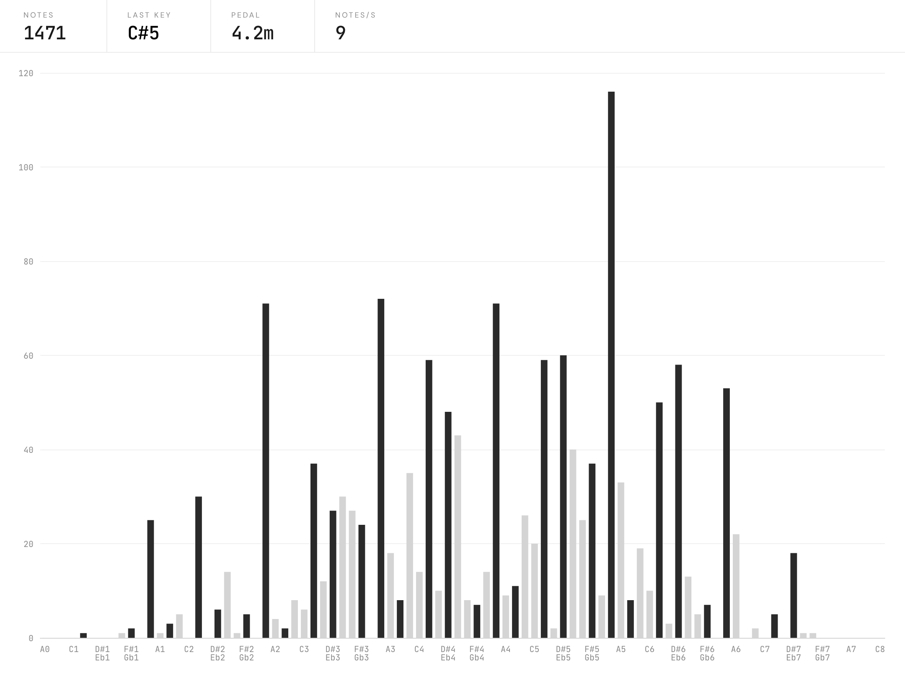
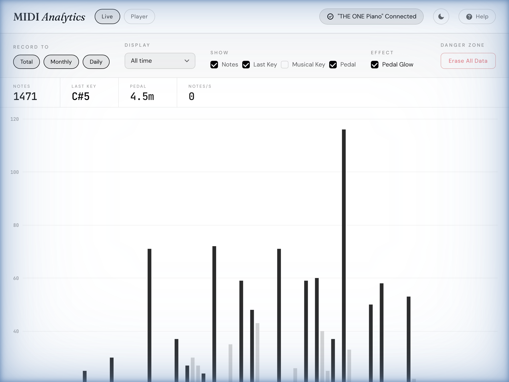
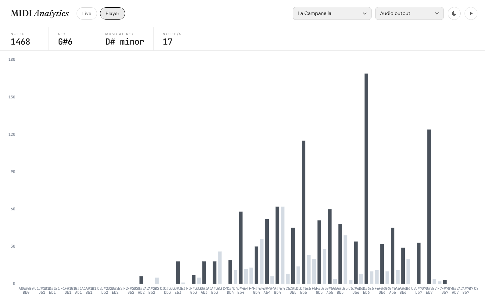

# MIDI Analytics

A browser-based MIDI visualizer and practice tracker. It shows which of the 88 piano keys you play and how often, and can play back built-in MIDI files through your browser or your keyboard.

**Live site: [midianalytics.netlify.app](https://midianalytics.netlify.app)**

## Live Mode

The Live page connects to a MIDI keyboard over USB or Bluetooth MIDI and tracks what you play:

- Note counts for each of the 88 keys, drawn as a bar chart (scroll to zoom)
- Notes, last key, notes per second, and estimated musical key
- Total sustain pedal time (CC64)
- Separate totals for all time, this month, and today
- Optional pedal glow effect
- Light and dark theme

Live mode needs a browser with the Web MIDI API (Chrome, Edge, or another Chromium browser). Safari does not support MIDI, so on iOS use the Web MIDI Browser app instead.





## Player Mode

The Player page comes with a few piano MIDI files (La Campanella, Hungarian Rhapsody No. 2, Fantaisie Impromptu, Moonlight Sonata, Liebestraum No. 3, and Rush E) and renders them on the same chart.

Audio output plays through a piano soundfont in the browser. MIDI output sends the notes to a connected keyboard or synth instead.



## Privacy

Note counts, pedal time, and theme settings are stored in your browser's localStorage and stay on your device. Erase All Data clears them.

## Project Structure

```
├── index.html          Live page
├── script.js           MIDI input, recording, chart
├── musical-key.js      Musical key estimator
├── player/             Player page (MIDI playback + visualization)
├── lib/                Vendored ECharts, math.js, WebMIDI
└── screenshots/        Screenshots used in this README
```

## Credits

The piano soundfont (`player/soundfont/acoustic_grand_piano-ogg.js`) is from [MIDI.js](https://github.com/mudcube/MIDI.js), MIT licensed. The Player page also loads [midi.js](https://github.com/mudcube/MIDI.js) (MIT), [ECharts](https://echarts.apache.org/) (Apache 2.0), and [math.js](https://mathjs.org/) (Apache 2.0).

## License

[Apache License 2.0](LICENSE)
